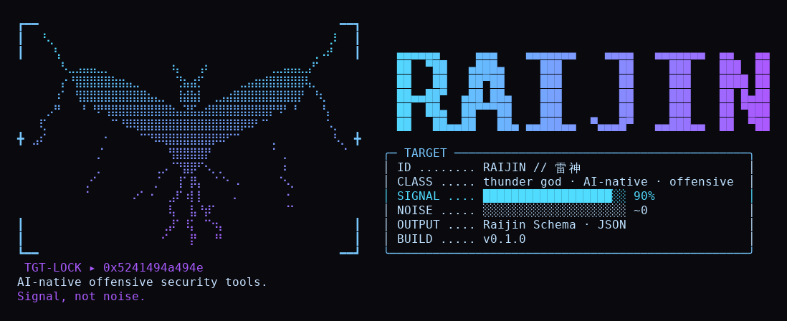

# ⚡ Raijin Scan

<p align="center">
  
</p>

**nuclei for AI agents: every finding, every location, a fraction of the tokens.**

`raijin-scan` is part of the [Raijin](https://github.com/protonnegativo/raijin) arsenal. It runs [nuclei](https://github.com/projectdiscovery/nuclei) underneath and returns the **Raijin Schema**: one compact JSON with the findings ranked by severity, every location where each one matched, info-level noise collapsed into groups, and a count of anything it had to cut.

## Why not just run nuclei?

nuclei is built for people and pipelines. An agent pays for every byte it reads. Its JSONL output repeats the template metadata, the `curl` command and the request and response once per match. The text output is one line per match and starts with a banner and log lines.

Here is the same scan, with the same matches, read by an agent (tokens, `o200k_base`):

| | **Broad scan**: 2,852 templates, 124 matches, all info | **Exposures**: 30 matches, 3 real findings (2 high, 1 medium) |
|---|---:|---:|
| nuclei `-jsonl` | 72,698 | 15,831 |
| nuclei `-jsonl -omit-raw` | 44,771 | 9,216 |
| nuclei text output | 3,675 | 938 |
| **raijin-scan** | **434** (**168×** fewer than JSONL) | **430** (**37×** fewer than JSONL) |

- **Nothing is lost.** Every nuclei match, a template plus the exact URL, is in the output. `bench/verify.py` checked all 154 matches in both scans and none were missing.
- **The real problems come first.** Findings are ranked by severity. 100 missing-header matches become one group: the 10 header names and the 10 URLs.
- **Output is bounded.** On a huge scan, `--max-bytes` cuts the least important data first and counts every cut. nuclei's output grows with hosts × templates.
- **Details are one file away.** nuclei's full JSONL is saved to disk, and its path is in `raw`. It holds the description, references, the `curl` command to reproduce, and timestamps, and it costs no tokens until the agent opens it.

Against nuclei's text output, the gap is smaller: 8.5× on the broad scan and 2.2× on the exposures scan. The text output also has no structure, no dedup and no ranking. Full method and numbers are in [BENCHMARK.md](BENCHMARK.md), and `bench/run.sh` reproduces them.

## Install

```bash
go install github.com/protonnegativo/raijin-scan/cmd/raijin-scan@latest
```

You also need `nuclei` on `PATH`, or pass `--nuclei <path>`.

## Usage

```bash
raijin-scan --scope scope.txt -l targets.txt -t http/exposures/ --max-items 10
raijin-scan --scope scope.txt -u https://app.example.com --severity critical,high
raijin-scan --scope scope.txt --input nuclei-results.jsonl     # reduce output you already have
raijin-scan --scope scope.txt -l targets.txt --state run.json  # mark findings that are new since last run
raijin-scan ... -- -H "Authorization: Bearer x"                # anything after -- goes to nuclei
```

`--scope` is required. One rule per line:

```
example.com
*.example.com
10.0.0.0/24
!admin.example.com
```

Targets outside the scope are dropped before nuclei runs, and results for out-of-scope hosts (for example after a redirect) are dropped from the output. Both are counted in `omitted.out_of_scope`.

## Output

```json
{
  "tool": "raijin-scan",
  "version": "0.1.0",
  "target": "2 target(s)",
  "summary": "2 findings (1 high, 1 medium), 0 info groups, 4 raw matches",
  "findings": [
    {
      "id": "laravel-env",
      "title": "Laravel - Sensitive Information Disclosure",
      "severity": "high",
      "cvss": 8.3,
      "locations": ["http://127.0.0.1:18081/.env", "http://localhost:18081/.env"]
    },
    {
      "id": "git-config",
      "title": "Git Configuration - Detect",
      "severity": "medium",
      "cvss": 5.3,
      "locations": ["http://127.0.0.1:18081/.git/config", "http://localhost:18081/.git/config"]
    }
  ],
  "groups": [],
  "raw": "/tmp/raijin-scan-3172893561.jsonl"
}
```

That is a real run (`-t http/exposures/configs/git-config.yaml -t http/exposures/configs/laravel-env.yaml` against a local lab), pretty-printed here and with the `raw` path shortened; the tool writes it as one line.

**Nothing nuclei found is dropped silently.** It runs every severity, like nuclei does by default. Every finding and every location where it matched is in the output. Only exact repeats collapse, and they are counted in `omitted.duplicates`.

What the reducer does:

- **One finding per template and matcher.** `locations` lists every URL where it matched, each with the values extracted there. Two different URLs on the same host are two locations.
- **CVE and CVSS** are included when the template has them. A CVE that is already the `id` is not repeated.
- **Info-level matches become `groups`**, one per template, unless you pass `--include-info`. Variants (for example the missing headers) that matched the same locations share one group. A variant that matched other locations gets its own group, so every variant/location pair is kept.
- **Ranking:** severity first, then the number of locations.
- **`raw`** is nuclei's full JSONL, saved to disk. It holds the description, references, the `curl` command to reproduce, and timestamps, and reading it costs no tokens until the agent opens it. `--raw <file>` picks the path.
- **Budget:** `--max-bytes` (16,000 by default) keeps the output bounded on huge scans. It cuts in this order until the JSON fits:
  1. info group locations;
  2. info groups;
  3. the locations of the lowest-ranked findings, each keeping one location plus its `count`;
  4. the lowest-ranked findings.

  Every cut is counted in `omitted`, `budget.truncated` is set, and `next` points to the raw file. `--max-items` caps the number of findings (0, the default, keeps all).
- **Errors** say what to try next. If nuclei is missing, the exit code is 2.

Fields an agent can rebuild are left out to save tokens:

- `count` appears only when the budget cut `locations`.
- `confidence` appears only when it is not `matched`.
- `omitted`, `errors` and `next` appear only when they are not empty.
- `budget` appears only when something was cut.

The nuclei template is the `id` up to the first `:`.

The JSON is compact (one line) by default because indentation costs about 30% more tokens; `--pretty` indents it (the example above is pretty-printed). `--format table` prints a short human view of the same result.

The banner above is **off by default**, so normal runs stay small. `--banner` prints it to **stderr** (never stdout, so the JSON is untouched), with the version taken from the binary. Colors are disabled when `NO_COLOR` is set or stderr is not a terminal.

## Flags

| Flag | Default | |
|---|---|---|
| `--scope` | (required) | scope file |
| `-u` / `-l` / `--input` | | one target (repeatable) / target file / existing nuclei JSONL |
| `-t`, `--tags`, `--severity` | | passed to nuclei |
| `--rate`, `--timeout` | | nuclei `-rl` / `-timeout` |
| `--max-items` | 0 | max findings (0 keeps all) |
| `--max-bytes` | 16000 | max JSON size; cuts are counted in `omitted` |
| `--raw` | temp file | where to save nuclei's full JSONL |
| `--include-info` | false | info matches as findings, not groups |
| `--state` | | state file for new-since-last-run |
| `--format` | json | `json` or `table` |
| `--pretty` | false | indent the JSON |
| `--nuclei` | nuclei | path to the binary |
| `--banner` | false | print the banner to stderr |

## Development

```bash
go test ./...
go vet ./...
```

Standard library only. nuclei runs as a subprocess with `-jsonl -omit-raw`, so the binary stays small and nuclei can be updated on its own.

## Roadmap

- `next` suggestions from detected tech.
- Optional embedded nuclei SDK instead of the subprocess.
- `raijin-mcp` will expose this tool to MCP clients.

## Responsible use

Only scan what you are authorized to test.
